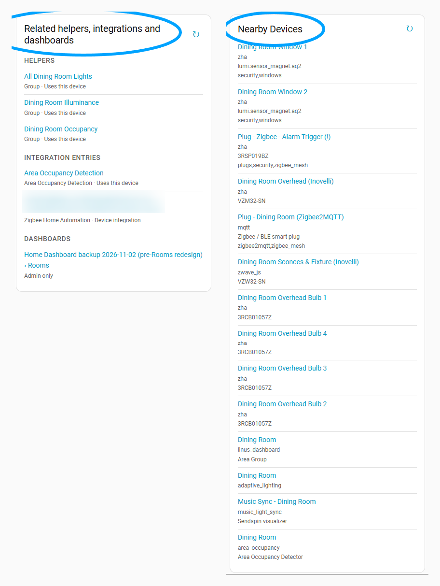

# Custom Device Page Components

Adds cards to Home Assistant **device pages**, and lets you build your own
cards without writing code.

## Compatibility

| | |
|---|---|
| Minimum Home Assistant | 2026.2.0 (declared in `hacs.json`) |
| Tested with | Core 2026.10.4 (automated tests); device-page markup checked against the frontend source of 2026-11-04 |
| Python | 3.13 / 3.14, as shipped by Home Assistant |
| Optional | ZHA, for the Zigbee bindings component |

The device-page card hooks into a part of the Home Assistant frontend that is
not a public API. If a frontend release changes the device page, the card
stops appearing (device pages keep working) and Home Assistant shows a
**Repair** issue. Update this integration, press
**Check and reload device page card**, and refresh the browser.

## What you get

**Built-in components** (turn each on or off under *Configure*):

- **Related helpers, integration entries and dashboards**: a card listing,
  with links, every helper and integration entry whose settings name the
  device or one of its entities, integrations whose entities list the device's
  entities as targets (`entities` / `entity_id` attributes, e.g. Scheduler
  schedules), the device's own integration entry, group
  helpers whose members include its entities, and every dashboard view that
  shows the device or one of its entities.
- **Color temperature**: boxes under *Configuration* on every light device
  with a color-temperature light: *Color temperature* (mireds) and *Color
  temperature (kelvin)*, each switched on or off in the options (both on by
  default). They show the current value; typing a value turns the light on at
  that temperature. Optionally only for chosen models.
- **Zigbee bindings (ZHA)**: *Zigbee bound to*, *Zigbee bound from* and
  *Read Zigbee bindings* on every ZHA device, plus *Read all Zigbee
  bindings* on the integration's own device. Reads only happen when you press
  a button; nothing is bound or unbound.

**Confirm config changes** (option, off by default): when on, changing any
control in a device page's *Configuration* section first asks **Save
config?** with the old and new value. *Cancel* (or Escape, or tapping outside)
sends nothing and puts the control back. Useful on phones, where scrolling
past a slider can move it.

**Placement**: each component, and the Related card, goes at the bottom of
device page column 1 (left), 2 (middle) or 3 (right). On narrow screens Home
Assistant shows a single column; cards then stack in column order.

**Your own components**: *Add component* on the integration's page opens a
builder:

| Step | What it does | SQL equivalent |
|---|---|---|
| Source table | Where rows come from | `FROM` |
| Joins | Combine with another table | `INNER / LEFT / RIGHT / FULL OUTER JOIN … ON` |
| Conditions | Keep matching rows; values can be typed or taken from the device whose page is open | `WHERE … AND / OR` |
| Grouping and summaries | Count, min, max, sum, average, list | `GROUP BY` |
| Sorting and row limit | Up to three sort columns, 1–500 rows | `ORDER BY`, `LIMIT` |
| Columns and row link | Up to 8 columns, and what a row opens (entity, device, area, integration entry, page). In *List* style the first column is the link and each other column is a small grey line under it, like the Related card | `SELECT` |
| Row actions | A button per row that runs a Home Assistant action | — |
| Which device pages | Device type (manufacturer/model, device or service), status (enabled/disabled, available/unavailable), integration, area | — |
| Preview | Runs the component for a device you pick | — |

Tables: devices, device ↔ integration entries, entities, current states,
areas, floors, labels, device/entity ↔ labels, integration entries,
dashboards, dashboard references, automations (name, Active/Inactive, link to
the editor), automation and script references (with the part — trigger,
condition or action — that makes the reference), group members (every group
entity and its members, with the group's platform, e.g. `group` for group
helpers), and the Related index.

**Recipe — automations that use a group this device is in**: source
*automation references*; join *group members* on reference entity = group
entity, and *automations* on source entity = automation entity. Conditions:
member device = *this device*, part in `trigger,condition`, group platform =
`group`. Group by automation name, status and edit link with a *list* of group
names. Columns: name, group names, status; row link: page, edit link; style
*List*.

## Example

Left: the built-in **Related helpers, integrations and dashboards** card.
Right: **Nearby Devices**, a component built in the no-code builder, placed in
column 3 in *List* style. Its settings:

| Step | Setting |
|---|---|
| Source table | Devices |
| Where | `area_id` is *this device's* `area_id` AND `disabled_by` is empty |
| Columns | `display_name`, `integration`, `model`, `labels` |
| Row link | Device page, using `id` |

Every device page then lists the other devices in the same area, each linking
to its own device page.

## Safety: what this integration will not do

- **No free-typed SQL.** The builder stores a description of the query;
  identifiers are checked against a fixed list and values are passed as
  parameters. Queries run on a private in-memory copy of registry and state
  data, switched to read-only before your query runs, and are stopped if they
  run too long. Home Assistant's own databases are never opened.
- **No changes to anything it does not own.** It never writes another
  integration's settings, the device or entity registries (except deleting
  its *own* entities when you turn a built-in off, after a warning), storage
  files, `configuration.yaml`, or dashboards.
- **Row actions** only call Home Assistant actions, as the person pressing
  the button, so Home Assistant's own permissions apply. The row's target is
  re-read on the server, never taken from the browser.
  - **Blocked**: anything that removes, deletes, purges, resets, restores,
    uninstalls, reboots, installs firmware or runs code, and every
    `homeassistant`, `hassio`, `backup`, `recorder`, `shell_command`,
    `python_script` and `pyscript` action. Restart/update buttons can't be
    pressed.
  - **Always confirmed**: locks, alarms, covers, valves, climate off/mode,
    `button.press`, turning switches/automations off, scripts, notifications.
- **Administrators only.** Device pages are admin-only in Home Assistant; every
  command of this integration checks for an administrator too.
- **Warnings before destructive changes**: turning a built-in off lists the
  entities that will be deleted; changing a component's source table or
  removing a join lists what is removed with it.

## Install

1. Marketplace (Home Assistant 2026.11+) or HACS: use the button above, or
   add `https://github.com/jacollins1/ha-custom-device-page-components` as a
   custom repository (category *Integration*).
   Manual: copy `custom_components/custom_device_page_components` into your
   configuration folder.
2. Restart Home Assistant.
3. *Settings → Devices & services → Add integration →
   Custom Device Page Components*.
4. Refresh the browser and open any device page.

## Known limits

- Template helpers defined in YAML don't expose what they read, so they can't
  appear in the Related list. YAML groups and every UI helper do.
- Dashboards built by a strategy are not scanned. A new dashboard appears in
  Related lists within a minute.
- RIGHT and FULL OUTER JOIN need SQLite 3.39 (Home Assistant OS and the
  container image have it).
- The Zigbee bindings component uses ZHA internals; a ZHA change can break
  that component on its own. Everything else keeps working.

## After each Home Assistant release

The `Validate` workflow runs weekly against the latest Home Assistant. Before
releasing for a new Home Assistant version: run the tests, open a device page
on the new version, check *Device page card* reports `attached`, then update
`TESTED_HA_VERSION` in `const.py` and this table.

## License

MIT
